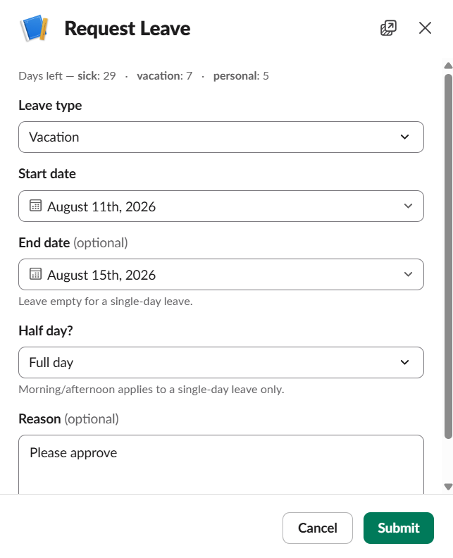
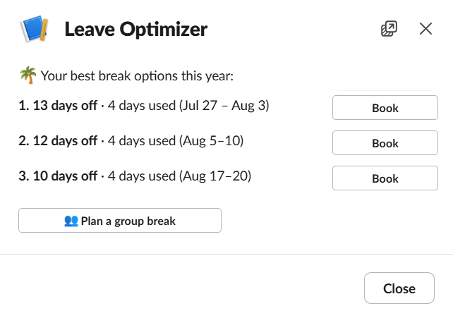
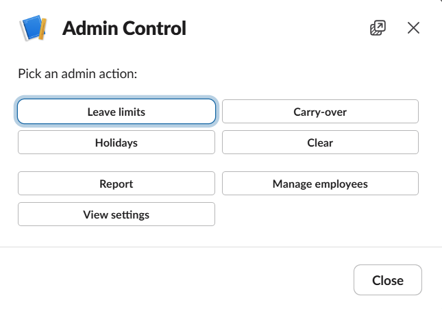
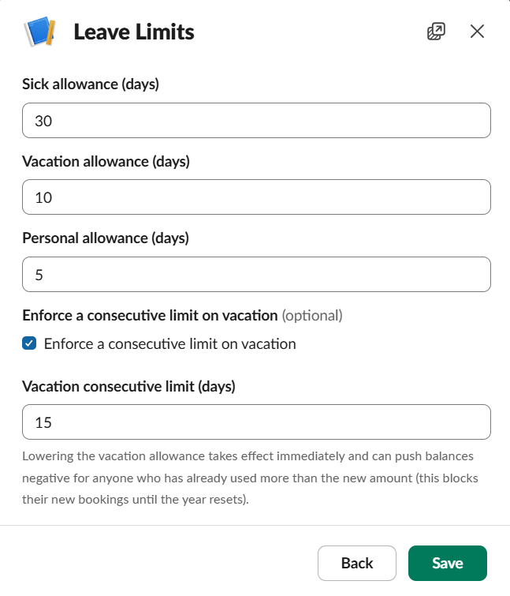

# Leave Management — a Slack leave bot

Request, approve, and track employee leave without leaving Slack. One slash command
replaces the "DM your manager, they note it down by hand" loop: the manager approves with
one click, approved leave lands on a shared Google Calendar and leave board, and balances
are tracked automatically.

> Built during my Data Scientist internship at **Toyota Tsusho Mobility Informatics Pte. Ltd.**
> (Jun–Jul 2026). I designed and built it end to end — requirements, architecture, AWS
> deployment, and tests.

| Request leave | Leave Optimizer | Admin control plane | Leave limits |
|:-:|:-:|:-:|:-:|
|  |  |  |  |

## Features

| Command | Who | What it does |
|---|---|---|
| `/dayoff` | Everyone | Request sick / vacation / personal leave, full or half day. The manager gets a one-click Approve / Decline card showing who else is out; people at the top of the chain are auto-approved. |
| `/dayoff-cancel` | Everyone | Cancel a pending or future request, or return early from leave in progress — only the days actually taken are charged. |
| `/advance` | Everyone | **Leave Optimizer** — finds the longest breaks your remaining days can buy, using weekends and public holidays as free bridges; can also find a window a group of teammates can all take off. Book straight from the card. |
| `/burnout` | Managers | Direct reports ranked by burnout risk (longest stretch without a break), with remaining vacation, an expiring-quota flag, and a one-click supportive nudge. |
| `/control` | Admins | Admin control plane inside Slack: leave limits, carry-over and leave-year reset date, holidays (add / remove / bulk import), CSV reports, employee management, and a guarded reset. |

## Engineering highlights

- **Serverless, scale-to-zero** — AWS Lambda (Slack HTTP mode) + DynamoDB on-demand,
  roughly **$0/month** at low usage; a keep-warm ping avoids cold-start Slack timeouts
  ([ADR-0007](docs/adr/0007-keep-warm-ping.md)).
- **Infrastructure as code** — Terraform, least-privilege IAM (the deploy role can't read
  leave data), secrets in SSM SecureString ([ADR-0003](docs/adr/0003-terraform-deploy-ssm-secrets.md)).
- **376 offline tests** — pytest + [`moto`](https://github.com/getmoto/moto) and fakes for
  Slack and Google, so the full suite needs no cloud access.
- **Decisions written down** — 10 [ADRs](docs/adr/), a domain glossary
  ([`CONTEXT.md`](CONTEXT.md)), and 42 issue specs in [`issues/done/`](issues/done/),
  each built as a thin end-to-end slice.

**Stack:** Python · Slack Bolt · AWS Lambda · DynamoDB · Terraform · Google Calendar & Sheets APIs · pytest / moto

**Docs:** [User manual](docs/USER_MANUAL.md) · [Software documentation](docs/SOFTWARE_DOCUMENTATION.md) ·
[Setup & deploy runbook](SETUP.md) · [What I learned](docs/what-i-learned.md)

## How it works

- **Slack** — slash commands (`/dayoff`, `/dayoff-cancel`) plus interactive modals and
  Approve/Decline buttons. Everything happens in bot DMs (no public channel).
- **AWS Lambda (HTTP mode)** behind a **Function URL** is the production entrypoint;
  Slack's request signature is the authenticator. Local development uses Slack
  **Socket Mode** instead.
- **DynamoDB** (on-demand) stores employees and leave requests.
- **Google Calendar** — an approved request creates an all-day event on a shared team
  calendar (tinted with the requester's stable colour); cancelling removes it.
- **Leave board** — a Google Sheet rendered as a people × days grid coloured by leave
  type, rebuilt on each approve/cancel; the bot posts an "updated 📋 link" message to a
  dedicated Slack channel. Opt-in via `LEAVE_BOARD_CHANNEL` + `LEAVE_SHEET_ID`.

Key decisions are recorded in [`docs/adr/`](docs/adr/):
- **ADR-0001** — DynamoDB for persistence
- **ADR-0002** — run on AWS Lambda in Slack HTTP mode
- **ADR-0003** — provision with Terraform; secrets in SSM SecureString
- **ADR-0004** — carry-over balance model (central policy + per-person stored carry-in)

## Leave model (V2)

- **Day counting** — weekdays only; **holidays** (a company-wide set) don't consume quota,
  and a half-day costs `0.5`. Balances are derived live from raw requests, so a
  newly-added holiday retroactively refunds overlapping leave.
- **Central policy** — base allowance and the caps live in one place (a reserved item),
  not per employee; an employee's own `allowances` map is an optional override.
- **Carry-over** — unused **vacation** rolls into the next year, capped by `max carry over`
  (what rolls out) and `max total` (in-year availability). Computed lazily and stored
  per person (ADR-0004). Sick/personal reset each year.
- **Consecutive limit** — a vacation request is rejected if it would create a continuous
  absence longer than the cap (default 15 calendar days; weekends, holidays, and all leave
  fill the run).

## Setup

The full step-by-step runbook is **[SETUP.md](SETUP.md)**. In short:

1. **Create the three external resources** — a Slack app, an AWS account, and a Google
   service account + shared calendar (SETUP §1–3).
2. **Local dev** — copy `.env.example` → `.env` and fill it in, then:
   ```bash
   python -m venv .venv && source .venv/bin/activate
   pip install -r requirements.txt
   python -m leave.seed        # provision tables + seed proxy employees
   python smoke_check.py       # expect PASS on Slack, Calendar, DynamoDB
   python app.py               # run locally over Socket Mode
   ```
3. **Production** — deploy with Terraform from WSL (SETUP §5): `terraform/build.sh`,
   `terraform apply`, set the SSM secrets, then point the Slack app at the Function URL.
   Resources run in **`ap-southeast-1`**.

## Repository layout

### Application
| Path | What it is |
|------|-----------|
| `app.py` | Bolt app factory (`build_app`) shared by both run modes, plus the **Socket Mode** entrypoint for local dev (`python app.py`). |
| `lambda_handler.py` | **Production** entrypoint — the AWS Lambda `handler` (Slack HTTP mode). Fetches secrets from SSM on cold start and writes the Google key to `/tmp`. |
| `leave/handlers.py` | Slack handler logic (open / submit / approve / decline / cancel) as plain functions, so tests can pass fakes. On Lambda the slow submit/approve/cancel work runs as lazy listeners (post-ack). |
| `leave/blocks.py` | Block Kit builders for the modals (incl. the half-day selector), the manager approval ticket, and decision notices; `format_period` shows the half. |
| `leave/view_state.py` | Reader for the Slack view-submission envelope — the one place that knows the `state.values` shape the form parsers read. |
| `leave/validation.py` | Request validation — dates, overlap, remaining balance, half-day rules, and the consecutive-absence limit. |
| `leave/balance.py` | Day counting: weekdays, holiday-aware, half-day (`0.5`). |
| `leave/absence.py` | Pure continuous-absence math — the worked-day predicate and the run extension, shared by the validator and the optimizer. |
| `leave/carryover.py` | Pure vacation carry-over roll-forward (the cap arithmetic from ADR-0004); no DB. |
| `leave/policy.py` | Central leave policy (base allowances + caps) as a reserved item; allowance resolution with per-employee override. |
| `leave/requests.py` | Leave-request persistence (DynamoDB) and derived balances; drives lazy vacation carry-in and the consecutive-absence calc (the pure math lives in `carryover.py` / `absence.py`). |
| `leave/holidays.py` | Holidays store + CSV apply + the holiday-set queries day-counting uses (degrades to "no holidays" if unprovisioned). |
| `leave/board.py` | The shared leave board — denormalized state + renders the Google Sheet + posts the Slack link. |
| `leave/db.py` | DynamoDB connection handle (employees / requests / holidays), employee lookup, and the `iter_employees` whole-table walk (skips reserved rows). |
| `leave/calendar_client.py` | Thin wrapper over the Google Calendar API; per-person event colours. |
| `leave/sheets_client.py` | Thin wrapper over the Google Sheets API; renders the leave-board grid. |
| `leave/seed.py` | Provision the tables (used by tests and initial setup), seed the central policy + **proxy** employees. |

### Infrastructure & docs
| Path | What it is |
|------|-----------|
| `terraform/` | The production stack as code — Lambda, Function URL, least-privilege IAM, SSM SecureString params, DynamoDB tables. State in S3. See ADR-0003. |
| `terraform/build.sh` | Builds the Lambda zip **in WSL** (Linux/x86_64 wheels). Run before `terraform apply`. |
| `SETUP.md` | One-time external-resource setup + the production deploy runbook. |
| `docs/adr/` | Architecture decision records. |
| `issues/` | In-repo copies of the tracker issues (`done/` for completed). |

### Operations / utilities
Run these **as yourself** (your own AWS credentials, which have DynamoDB/Calendar
access — *not* the deploy role), with the venv active. They target `ap-southeast-1`.

| Script | What it does |
|--------|-------------|
| `python smoke_check.py` | Health check across Slack, Google Calendar, and DynamoDB. Expect `PASS`. |
| `python -m leave.seed` | Provision the tables and seed the central policy + **proxy** test employees. |
| `add_employees.py` | Seed / edit the **real** employees (member id + manager; optional allowance override). Copy from `add_employees.example.py`. |
| `import_holidays.py` | Apply a holidays CSV: upsert the `holidays` store + mirror all-day events onto the calendar. Copy/edit `holidays.example.csv`. |
| `recompute_carry.py` | Rebuild a stored vacation `carry_in` for an employee/year after a closed year is edited. |
| `clear_requests.py` | Reset: empty `leave_requests`, delete their calendar events, **and** reset the leave board (drop state + blank the sheet). Keeps employees + central policy. |
| `clear_calendar.py` | Delete calendar events **not** tracked by any DynamoDB row (orphaned / old events); keeps the ones still linked to a request. |

> The deploy role manages **infrastructure only** — it has no DynamoDB item permissions.
> Run the data scripts above as your own user (drop the role creds first:
> `unset AWS_ACCESS_KEY_ID AWS_SECRET_ACCESS_KEY AWS_SESSION_TOKEN`).

## Run modes
- **Local development — Socket Mode:** `python app.py` (uses `SLACK_APP_TOKEN`; no public URL).
- **Production — HTTP mode on Lambda:** `lambda_handler.handler` behind the Function URL,
  provisioned by Terraform (uses `SLACK_SIGNING_SECRET`). Scale-to-zero.

## Tests
Fully offline on [`moto`](https://github.com/getmoto/moto) — no real AWS, Slack, or Google:
```bash
pip install -r requirements.txt
pytest
```

## Notes
- **Region:** the production stack runs in **`ap-southeast-1`** (Singapore); the Terraform
  state bucket is in `ap-southeast-7`. `ap-southeast-7` can't host Lambda Function URLs yet
  (see ADR-0003).
- **One workspace at a time:** the bot serves whichever Slack workspace the configured bot
  token belongs to. Pointing it at another workspace means updating the SSM token/secret.
- **Holidays are deferred in production:** the `holidays` table isn't created yet (the
  deploy role lacks `dynamodb:CreateTable` on it), so day-counting currently runs in a
  graceful "no holidays" mode. To enable: an admin widens the deploy role for
  `leave_holidays`, restore the table + `HolidaysRead` IAM blocks in `terraform/main.tf`
  (a note there lists the 3 steps), `terraform apply`, then run `import_holidays.py`.
- **Leave board setup:** enable the Google Sheets API on the project, create a sheet and
  share it (Editor) with the service account, then set `LEAVE_SHEET_ID` and
  `LEAVE_BOARD_CHANNEL` (and invite the bot to that channel). Empty values disable the
  board.
